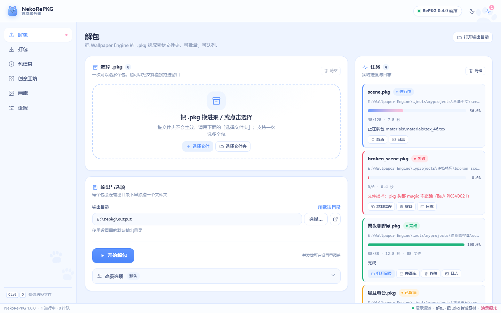
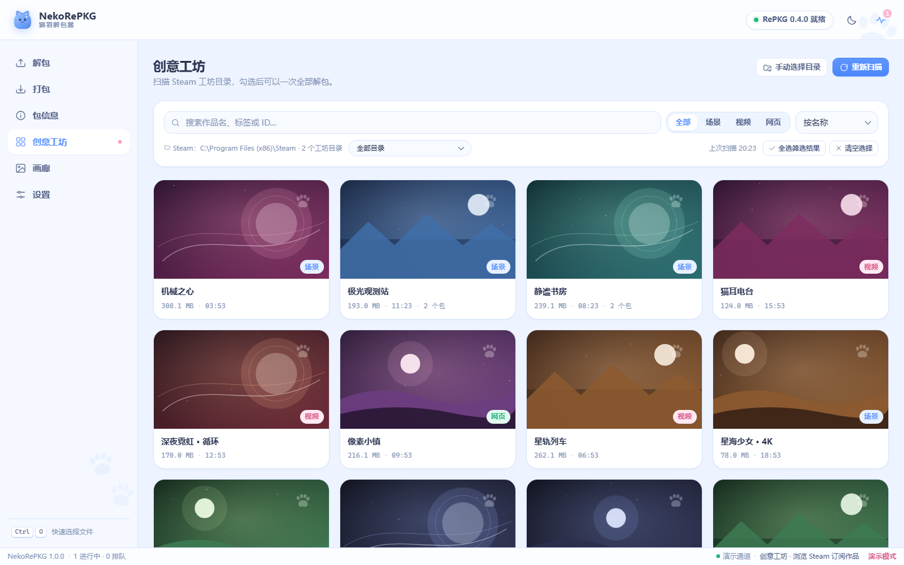
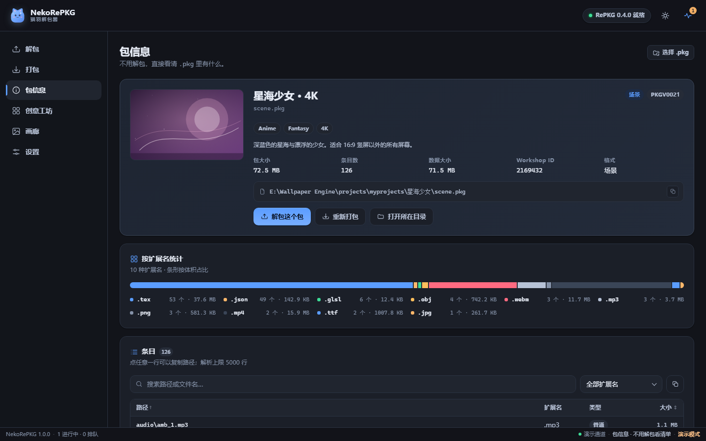
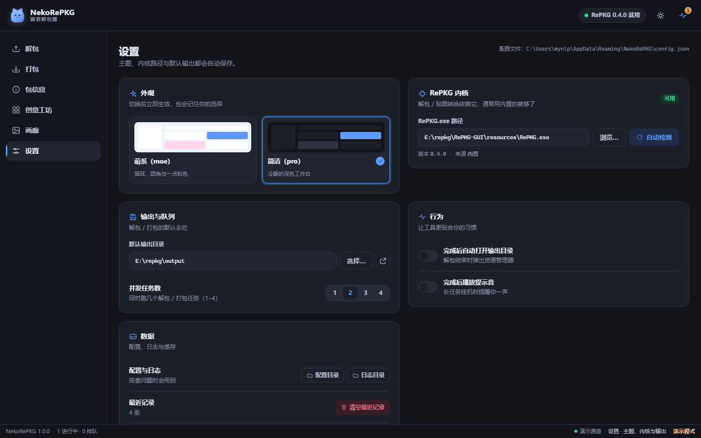
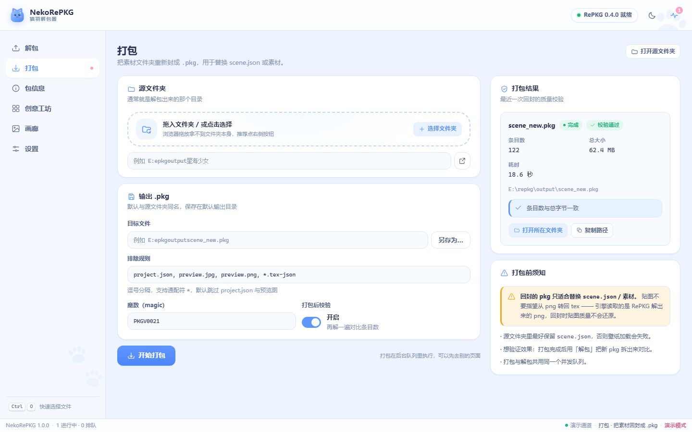
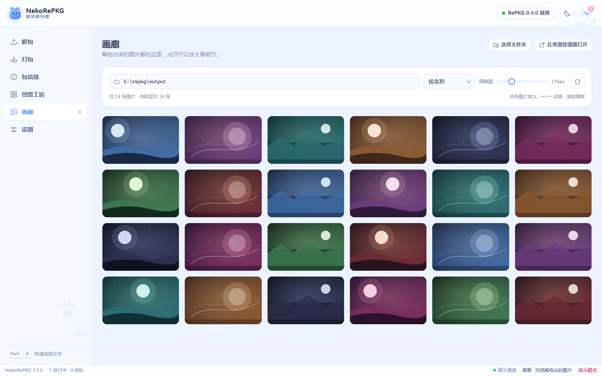

# NekoRePKG · 猫羽解包器

把 Wallpaper Engine 的 `.pkg` / `.tex` 解包、浏览、重新打包的 **图形界面工具**。
底层解包内核是 [RePKG](https://github.com/NotScuffed/RePKG)（NotScuffed，MIT），但不需要敲任何命令：双击即用，全中文界面。

- **官网**：<https://ynlp0624.github.io/NekoRePKG/>（静态页在 `docs/`，GitHub Pages 托管）
- **下载**：<https://github.com/ynlp0624/NekoRePKG/releases/latest>
- **仓库**：<https://github.com/ynlp0624/NekoRePKG>
- **国内镜像**：<https://gitcode.com/gcw_YiSvwnI0/NekoRePKG>（Release 附件下载约 6 MB/s）


## 功能

- **解包**：拖入或选择 `.pkg`（支持多个/整个文件夹），一键解出素材与贴图 PNG；完整选项（仅/忽略扩展名、单目录、递归、复制 project.json、用作品名命名、不转贴图、覆盖）。
- **包信息**：不用解包就能看条目表（路径/类型/大小，可搜索排序筛选）、按扩展名统计、`project.json` 详情、封面预览。
- **重新打包**：把修改过的素材文件夹回封成 `.pkg`（RePKG 官方不支持，本工具自研写入器），并自动用 RePKG 回读校验。
- **创意工坊**：自动找到 Steam 的 Wallpaper Engine 工坊目录（appid 431960），封面墙浏览、搜索筛选、多选批量解包。
- **画廊**：解包结果缩略图墙 + 灯箱大图（缩放、左右切换、打开原图/所在目录）。
- **任务队列**：多任务并行、实时进度与日志、可取消，完成后一键打开输出目录。
- **双主题**：萌系（默认）/ 简洁，设置里切换；完全离线，无任何联网请求。

## 界面预览

| 解包（萌系） | 创意工坊（萌系） |
| --- | --- |
|  |  |

| 包信息（简洁） | 设置（简洁） |
| --- | --- |
|  |  |

| 重新打包（萌系） | 画廊（萌系） |
| --- | --- |
|  |  |

## 使用

1. 双击 `NekoRePKG.exe`（单文件版）或 `NekoRePKG-win64\NekoRePKG.exe`（文件夹版，启动更快）。
2. 「解包」页：点「选择 .pkg」或把文件拖进窗口 → 选输出目录 → 开始解包。
3. 解包完成后点「去画廊」看贴图，或「打开目录」。
4. 「工坊」页会自动扫描本机壁纸，多选后可批量解包。
5. 想修改壁纸：解包 → 改文件 → 「打包」页选文件夹回封成 pkg → 放回工坊目录替换。

> 首次启动可能需要 3~10 秒（单文件版要解压运行时；文件夹版只需 2~3 秒），之后窗口会直接出现。

## 常见问题

**需要另外下载 RePKG 吗？**
不需要。RePKG 0.4.0 已经**内置在下载包里**（[RePKG 项目主页](https://github.com/NotScuffed/RePKG)，作者 NotScuffed，MIT）：单文件版运行时解压到临时目录，文件夹版就在 `resources\RePKG.exe`。你只需要下载 NekoRePKG 本身。

**杀毒 / SmartScreen 提示？**
本工具是自编译的未签名程序，Windows 可能提示「未知发布者」。点「更多信息 → 仍要运行」即可。如果开启了「智能应用控制」，可能直接拦截未签名程序，需要临时关闭（设置 → 隐私和安全性 → Windows 安全中心 → 应用和浏览器控制）。

**找不到 RePKG.exe？**
内置了一份 RePKG 0.4.0；如果被移动/删除，到「设置 → RePKG」里点「自动检测」，或手动指定 `RePKG.exe` 路径（也可以换成自己编译的版本）。

**解出来的贴图不是 png？**
贴图格式（DXT1/3/5、RG88 等）由 RePKG 转换；个别特殊格式会失败并在日志里提示，原 `.tex` 文件仍会保留。

**重新打包要多久？**
按文件总大小读一遍写一遍；几百 MB 的素材几秒钟。打包后会再用 RePKG 回读校验（可在打包页关掉）。

**解包会不会破坏原文件？**
不会，只读取。解包默认不覆盖已有文件，勾选「覆盖已存在」才覆盖。

## 数字签名

发布的 `NekoRePKG.exe` 带 **Authenticode 数字签名**：

- 签名工具：[ShizukuCodeSign](file:///D:/sing/codesign/README.md)（自建签名工房，纯 PowerShell + Windows 组件）
- 签名者：`CN=猫羽雫, OU=签名部, O=自家工房, C=CN`（RSA 2048 / SHA-256 / 带 DigiCert 可信时间戳）
- 在本机（当前 Windows 账户）证书已受信任，右键 exe → 属性 → 数字签名会显示「签名已通过验证」

换一台机器想让它显示为可信，需要把证书导入那台机器的证书库：

| 文件 | 导入位置 |
| --- | --- |
| `D:\sing\codesign\pki\profiles\demo\ca\root.cer` | 受信任的根证书颁发机构 |
| `D:\sing\codesign\pki\profiles\demo\code-signing\leaf.cer` | 受信任的发布者 |

> 「导入到受信任的根证书颁发机构」会弹权限确认，属于正常现象；只对当前用户生效时选「当前用户」。

自签名的边界：**SmartScreen / 杀毒软件看的是信誉，不是签名本身**。别人第一次运行仍可能看到「未知发布者」或 SmartScreen 提示，需要点「仍要运行」；想彻底消除得购买 OV/EV 代码签名证书并积累下载信誉。

重新构建时默认自动签名（`build\build.ps1`，签名失败只警告不影响出包）：

```powershell
powershell -File build\build.ps1                     # 构建 + 自动签名（档案 demo）
powershell -File build\build.ps1 -NoSign             # 跳过签名
powershell -File build\build.ps1 -SignProfile studio # 换一个证书档案
```

## 从源码构建

需要 Python 3.11+（开发用的是 3.14）与 Windows 10/11：

```powershell
# 依赖（清华镜像）
python -m venv .venv
.venv\Scripts\python -m pip install -i https://pypi.tuna.tsinghua.edu.cn/simple pywebview pyinstaller pillow

# 开发运行
.venv\Scripts\python run_app.py

# 构建（单文件 + 文件夹版）
pwsh -File build\build.ps1
```

产物在 `dist\`：
- `NekoRePKG.exe` — 单文件版（约 40–60 MB）
- `NekoRePKG-win64\` + `NekoRePKG-win64.zip` — 文件夹版（启动快）

调试：`NEKOREPKG_DEBUG=1` 启动可打开 WebView2 开发者工具；日志在 `%APPDATA%\NekoRePKG\logs\app.log`。

## 测试

```powershell
.venv\Scripts\python tests\test_pkgfmt.py        # pkg 读写 + RePKG 交叉验证
.venv\Scripts\python tests\test_scanner.py       # Steam/工坊扫描
.venv\Scripts\python tests\test_api_smoke.py     # HTTP/REST/SSE 端到端
```

## 目录结构

```
app\
  main.py         启动窗口
  server.py       本地 HTTP + SSE
  api.py          REST 接口
  core\           pkgfmt（pkg 读写）/ scanner（工坊）/ repkg（CLI 封装）/ jobs（队列）/ dialogs / config
  web\            前端（纯静态 HTML/CSS/JS，双主题）
resources\RePKG.exe
build\            图标、版本信息、构建脚本
tests\            测试与 fixture
```

## 致谢与许可

- [RePKG](https://github.com/NotScuffed/RePKG) © NotScuffed（MIT）——解包/贴图转换内核，`resources\RePKG.exe` 原样分发，第三方许可见 `THIRD-PARTY-NOTICES.txt`。
- [pywebview](https://pywebview.flowrl.com/)、[pythonnet](https://pythonnet.github.io/)、[Pillow](https://python-pillow.org/)。
- 本项目代码 MIT。请仅用于个人备份与创作，尊重原作者的版权与工坊使用条款。
